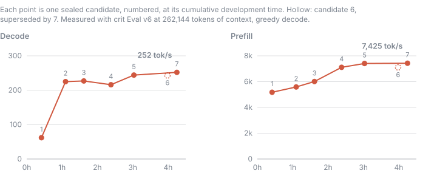
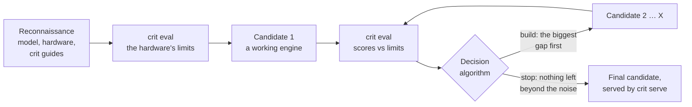

<div align="center">

<p align="center">
  
  
  <br />
</p>

### Why wait for someone to optimize an LLM for your GPU when an AI agent can build a specialized inference engine in a few hours?

[](CHANGELOG.md)
[](LICENSE)
[](https://github.com/crit-labs/crit-hub)
[](https://github.com/crit-labs/crit/actions/workflows/ci.yml)

[Summary](#summary) • [Quick start](#quick-start) • [What crit solves](#what-crit-solves) • [Case studies](#case-study) •
[How crit works](#how-crit-works) • [API](#api) • [CLI](#cli) • [crit-hub](#crit-hub) • [Limitations](#limitations) • [Documentation](#documentation)

</div>

---

<a id="summary"></a>

## Summary

**`crit` is a toolkit for optimizing or building inference engines tailored to your hardware and desired model.**
> [!IMPORTANT]
> Combines a runtime foundation, reusable techniques, kernel discovery
> and physics-based evaluation. In our first case study, a coding agent built an engine for
> Qwen3.8-27B on one RTX 5090 in about 4 hours and seven candidates,
> reaching 252 tok/s greedy decode with the model's full 262,144-token context.
> You get runnable source, measured candidate comparisons and an OpenAI-compatible API.
> 
> Follow the [building guide](docs/BUILDING_ENGINES.md) yourself, or give your coding
> agent the [agent instructions](AGENTS.md), target model and hardware.

---

<a id="quick-start"></a>

## Quick start

Give one of these prompts to your coding agent and specify your target LLM or target engine:
```bash
Use github.com/crit-labs/crit to build an optimized inference engine for <huggingface_url>.
```

```bash
Use github.com/crit-labs/crit to optimize my own inference engine in <engine_reference>.
```

---

<a id="what-crit-solves"></a>

## What `crit` solves

**The boring stuff has already been built ⏱️** 
> Requests, memory management and cleanup
> eat up development time before optimization even starts. `crit` supplies a clean
> foundation so you can get to the work that makes your engine fast.

**Curated high-impact inference strategies 📊** 
> Don't rebuild inference strategies from scratch. We studied established
> inference engines and distilled their core speedup strategies into reusable code, so you can
> apply what works to your model and hardware quickly.

**Physics-based evaluation suite 🔬** 
> A benchmark score alone doesn't tell
> you what's still left on the table. `crit` measures your hardware's limits and shows
> how close your engine gets, with quality and correctness checks along the way.

---

<a id="case-study"></a>

## Case Studies

> [!NOTE]
> Find the referenced engines in our [`crit-hub`](https://github.com/crit-labs/crit-hub) repository.

We gave `Claude Opus 5.5` a target LLM along with the `crit` repository and let it cook autonomously.

| What it shows | Evidence |
| --- | --- |
| **Fast engines** | Qwen3.8-27B on one RTX 5090: 252 tok/s greedy decode, 4x its own first working candidate, and 7,425 tok/s prefill, with the full 262,144-token context |
| **No quality traded for speed** | Perplexity within 0.1% of the reference, 5.8% of the drift budget; drafting reproduces plain greedy decoding token for token |
| **Hours, not weeks** | 4h 15m and seven candidates from the run's first command to the selected engine, $42 at API list prices |
| **Every step is evidence** | Each candidate is sealed with its exact source and its Eval result, so the table below is a record, not a recollection |
| **Honest about what is left** | Prefill runs at 50% of the GPU's measured compute ceiling; Eval reports that gap next to the score |
| **Next** | Gemma 4 31B (dense), and Qwen3.8-Flash-Next and Nemotron 3.5 Super 120B, mixture-of-experts models larger than VRAM |

---

<details>
<summary><strong>📋 Dense LLM, Qwen architecture</strong> → <a href="https://github.com/crit-labs/crit-hub/tree/main/engines/crit-labs/mtp7-device-confidence">Inspect engine</a></summary>

<br />

**Goal:** Get to a fast, working engine for a dense model as quickly as possible.
**Limit:** A fixed candidate budget.

<div align="center">
<table>
  <tr>
    <td align="center" width="16%">
      <strong>

4h 15m</strong>

Development time
    </td>
    <td align="center" width="16%">
      <strong>

252.4 tok/s</strong>

Decode
    </td>
    <td align="center" width="16%">
      <strong>

7,425 tok/s</strong>

Prefill
    </td>
    <td align="center" width="16%">
      <strong>

150 ms</strong>

TTFT
    </td>
    <td align="center" width="16%">
      <strong>

+0.1%</strong>

Perplexity vs reference
    </td>
    <td align="center" width="16%">
      <strong>

0.0028</strong>

Mean KL divergence
    </td>
  </tr>
</table>
</div>

<br />

[`mtp7-device-confidence`](https://github.com/crit-labs/crit-hub/tree/main/engines/crit-labs/mtp7-device-confidence)
runs Qwen3.8-27B in its original NVFP4 weights on one RTX 5090, with the model's full 262,144
tokens of context. One coding agent built it from scratch on crit 0.5.0, writing its own kernels
on Core without using another inference engine as a reference. It drafts up to 7 tokens per round
with the model's own built-in draft layer and stops once the drafter's confidence in its latest
draft falls below 0.5; the GPU makes that decision inside one CUDA graph per round, so the host
never waits mid-round.

<p align="center">
  
</p>

| Candidate | What changed | Decode | Prefill | TTFT | Dev time, cumulative | Agent tokens, cumulative | API equivalent, cumulative |
| --- | --- | ---: | ---: | ---: | ---: | ---: | ---: |
| 1 | Working engine: reads the checkpoint as stored, 8-bit KV cache, no drafting | 62 tok/s | 5,176 tok/s | 210 ms | 0h 25m | 16.1M | $4.25 |
| 2 | Drafts 4 tokens ahead with the model's draft layer, tensor-core decode GEMVs | 225 tok/s | 5,584 tok/s | 187 ms | 1h 06m | 42.9M | $12.55 |
| 3 | 8-bit prompt attention | 227 tok/s | 6,010 tok/s | 184 ms | 1h 37m | 70.7M | $19.73 |
| 4 | cuBLASLt for the prompt's 4-bit and 8-bit matrix multiplies | 216 tok/s | 7,111 tok/s | 156 ms | 2h 23m | 108.0M | $29.68 |
| 5 | Drafts 7 tokens ahead | 244 tok/s | 7,408 tok/s | 151 ms | 3h 02m | 128.2M | $34.58 |
| 6 | Stops drafting once the drafter's confidence falls below 0.5, decided on the host (superseded: host waits made rounds jitter and failed the lower-context check) | 243 tok/s | 7,102 tok/s | 152 ms | 3h 59m | 154.6M | $41.96 |
| **7** | **The same stopping rule, decided on the GPU inside one CUDA graph per round** | **252 tok/s** | **7,425 tok/s** | **150 ms** | **4h 15m** | **155.7M** | **$42.30** |

The last three columns are running totals from the run's first command (01:16:25 UTC) to each
candidate's seal, and for candidate 7 to its selection, so its row is the whole run. Agent tokens
and API equivalent count the agent's messages in that span, from its Claude Code session transcript:
Claude Opus 5.5 for every message, priced at Anthropic's API list prices ($4/MTok input, $20/MTok
output, $8/MTok 1-hour cache writes, $0.20/MTok cache reads; 99% of the tokens are cache reads). The
agent writes the next candidate while the previous one is measured, so most of candidate 7 was built
before candidate 6 was sealed: from there to its selection added only 16 minutes and 1.1M tokens.

Measured with crit Eval (v6) at the full 262,144-token context. Decode is greedy (temperature 0), the
geometric mean over
six prompts, from a chat question to a 14K-token agent session; Eval decodes each engine's own
output, so candidates 3 and 4 have the same round time but accept different numbers of drafts.

- **Long context:** a prompt that fills all 262,144 tokens gets its first token after 79 s, then
  decodes at 244 tok/s. On prompts outside Eval's speed suite, in 8 languages and code, it decodes
  at 163 tok/s.
- **Quality:** perplexity stays within 0.1% of the reference, 5.8% of the drift budget, and
  drafting never changes the output: it is token for token what plain decoding produces.
- **Sampled requests:** this engine drafts only on greedy requests. With sampling (temperature 0.6 to
  1.0, including the defaults `crit serve` applies) it decodes one token per pass, at 59–60 tok/s on
  the same six cases, measured outside Eval. crit Eval v7 measures sampled decode too.

</details>

---

<details>
<summary><strong>📋 Dense LLM, Gemma architecture</strong> → TBD</summary>

<br />

**TBD.** We are rebuilding this case study with crit 0.5.0; its engine and figures follow shortly.

</details>

---

<details>
<summary><strong>📋 MoE LLM, VRAM overload, Qwen architecture</strong> → TBD</summary>

<br />

**TBD.** We are rebuilding this case study with crit 0.5.0; its engine and figures follow shortly.

</details>

---

<details>
<summary><strong>📋 MoE LLM, VRAM overload, Nemotron architecture</strong> → TBD</summary>

<br />

**TBD.** We are rebuilding this case study with crit 0.5.0; its engine and figures follow shortly.

</details>

---

<a id="how-crit-works"></a>

## How `crit` works

An agent, or you, builds the engine as a series of candidates. Each candidate is a complete,
servable engine, measured the same way, and each next one is chosen from the last one's numbers.



1. **Reconnaissance.** Gather everything the engine depends on before writing code: the user's
   model, hardware, workload, quality and context needs; the model's files (`crit run ... recon`
   reads its config, tokenizer, chat template, sampling defaults and draft layers); its model card
   and reference implementation; crit's [agent instructions](AGENTS.md), guides and docs; and any
   [crit-hub](https://github.com/crit-labs/crit-hub) engine to start from.
2. **Learn the hardware's limits.** `crit eval probe` measures the GPU, and Eval turns the
   measurements into the fastest decode, prefill and time to first token this model could reach on it.
3. **Build candidate 1:** a working engine on [Core](#core), measured by Eval. It sets the baseline.
4. **Decide what the next candidate changes.** The [decision algorithm](docs/RUN_RECORDS.md#plan) reads
   the last Eval and names the KPI furthest from its limit, the levers that close the gap, and a
   forecast crit checks after the build.
5. **Build candidate 2, 3, …**, each measured by Eval and compared with its forecast.
6. **Stop at the final candidate** once neither decode nor prefill can still move beyond its noise.
   It is selected, sealed with its source and evidence, and served through an OpenAI-compatible API.

Every step is recorded through the [CLI](cli/README.md): each candidate freezes its source by hash,
each measurement points at that exact package, and the run's cost is counted from the agent's own
transcripts ([run records](docs/RUN_RECORDS.md)).

---

<a id="core"></a>

<details>
<summary><strong>📗 Core</strong> → <a href="core/README.md">Full guide</a></summary>

<br />

**Core is the plumbing every engine needs, distilled from about 30 bespoke inference engines.**
> We took apart how each engine handles requests, memory, text and model files, kept the base
> features they all rebuild, and turned them into one native SDK. Your engine keeps what makes it
> fast: the model, its kernels, its layouts and its execution strategy.

| Part | What it does |
| --- | --- |
| [Runtime](core/src/runtime/README.md) | Admits, schedules, cancels and retires requests, and publishes their output |
| [Engine libraries](core/src/runtime/README.md#engine-libraries) | A C ABI that turns an engine into a shared library, with stock Eval and serve adapters |
| [Memory](core/src/memory/README.md) | Resource budgets, reservations and host-memory admission |
| [Text](core/python/crit_core/text/README.md) | Tokenizer and chat template loading, stop strings and streamed reply text |
| [Sampling](core/src/sampling/README.md) | Sampling rules, penalties, log-probabilities and greedy draft acceptance |
| [State cache](core/src/state/README.md) | KV pages, recurrent state slots and prefix-cache snapshots |
| [Model files](core/python/crit_core/model/README.md) | Safetensors and GGUF checkpoints, `config.json`, generation defaults and stop tokens |
| [Files](core/src/io/README.md) | Strict JSON, read-only, chunked and mapped file reads, SHA-256 |
| [Structured output](core/src/constraints/README.md) | Token masks for choices, JSON schemas and grammars |
| [Device graphs](core/src/backends/cuda/README.md#graph-capture) | CUDA graph capture and replay to cut launch overhead |
| [CUDA backend](core/src/backends/cuda/README.md) | Allocations, streams, shared device memory and device time per category |
| [Tracing](core/src/runtime/README.md#lifecycle-tracing) | A bounded lifecycle trace with operator ranges and NVTX |
| [Contracts](core/contracts/README.md) | Who owns what between Core and your engine |

Try the [Core + Inference walkthrough](inference/examples/core-projection/README.md).

</details>

---

<a id="inference"></a>

<details>
<summary><strong>📕 Inference</strong> → <a href="inference/README.md">Full guide</a></summary>

<br />

**Inference is our register of speed-up strategies, curated from about 50 inference engines.**
> We studied what makes each engine fast and turned every strategy that holds beyond one model or
> GPU into an entry. Your agent picks the entries that match its engine's bottleneck and builds them
> into the engine on Core.

| Bottleneck | Example entries |
| --- | --- |
| One token per pass | [Speculative decoding](inference/mtp-decode/README.md), [draft trees](inference/draft-trees/README.md), [device-side rounds](inference/device-speculative-round/README.md), [EAGLE-3 and DFlash drafters](inference/hidden-state-drafters/README.md) |
| Weight bytes per pass | [Quantized projections](inference/quantized-projections/README.md), [stored-tile FP8 and NVFP4 GEMMs](inference/stored-tile-gemm/README.md), [GGUF projections](inference/gguf-projections/README.md) |
| Long context | [FP8 KV attention](inference/fp8-kv-attention/README.md), [flash prefill](inference/flash-prefill-attention/README.md), [paged attention](inference/paged-attention/README.md), [prefix checkpoints](inference/checkpoint-storage/README.md) |
| Model larger than VRAM | [Expert residency](inference/expert-residency/README.md), [device expert cache](inference/device-expert-cache/README.md), [dense layer offload](inference/dense-layer-offload/README.md) |
| Hybrid recurrent layers | [Recurrent layer kernels](inference/recurrent-layer-kernels/README.md), [recurrent state recovery](inference/recurrent-state-recovery/README.md) |

All 37 entries are in the [full guide](inference/README.md), or run `crit inference search <query>`.

**Every entry has the same layout**

| Part | What it holds |
| --- | --- |
| `README.md` | When to use it, how it works, a worked example, how to adapt it, its costs and how to validate it |
| `code/` | Real implementation code, C++, CUDA or Python, with runnable examples |
| `entry.json` | When to use and avoid it, what the code provides, what the engine must supply and what it must preserve |

**What gets in: the [contribution criteria](docs/CONTRIBUTION_CRITERIA.md)**

| Criterion | Means |
| --- | --- |
| Shown value | A measured gain, a reproduced and fixed bug, or a capability engines had to rebuild themselves |
| No overfitting | Nothing in it is true only for the model or GPU where it was found |
| Broad use | Dense, MoE, hybrid and multimodal models and other CUDA GPUs use it unchanged or are unaffected |

</details>

---

<a id="eval"></a>

<details>
<summary><strong>📚 Eval</strong> → <a href="https://github.com/crit-labs/crit-eval">Full guide</a></summary>

<br />

`crit-eval` is a speed and quality measurement tool to compare inference engines honestly.

**There is no shared way to measure a bespoke inference engine.**
> Different bespoke inference engines report vastly different types of numbers. An honest comparison requires
> downloading and running the engines yourself. `crit-eval` finally makes apples-to-apples comparison possible.

**Physics-based evaluation lets you see what performance is left on the table.**
> `crit-eval` measures your GPU's memory bandwidth and matrix-multiply rates and turns them into a limit for each
> score. Its evaluation report can tell your coding agent how much performance can still be squeezed out of your
> inference engine.

**Speed that can't hide a quality loss.**
> Many inference engines push decode and prefill speed with no regard for quality. `crit-eval` treats quality
> as a first-class KPI. It measures not only inference speed but also quality regressions.

**A hardware report rounds out the evaluation.**
> The same model on the same inference engine but on two different machines can also lead to different inference
> speeds, even if the GPU is the same. We make this transparent by also reporting the runner's hardware configuration.

</details>

---

<a id="kernels"></a>

<details>
<summary><strong>📘 Kernels</strong> → <a href="kernels/README.md">Full guide</a></summary>

<br />

**Kernels helps you find and assess existing kernels** for your data format and
hardware, including the [Hugging Face Kernel Hub](https://huggingface.co/kernels).
It checks declared compatibility, shows mismatches and gaps, and retains chosen
artifacts with exact versions and license notices. Your engine then measures
whether the kernel helps.

</details>

---

<a id="models"></a>

<details>
<summary><strong>📙 Models</strong> → <a href="models/README.md">Full guide</a></summary>

<br />

**Models produces transformed weights** when a run allows them, starting with
post-training quantization to FP8 or NVFP4 (round-to-nearest or GPTQ). It exports a
checkpoint engines can read, runs it in your engine through Eval against the original
model, and records the recipe, calibration data, seed, file hashes and cost.

</details>

---

<a id="api"></a>
<a id="serving"></a>

<details>
<summary><strong>🔌 API</strong> → <a href="api/README.md">Overview</a> · <a href="docs/SERVING.md">Full guide</a></summary>

<br />

`crit serve` loads a sealed candidate, keeps it resident and answers OpenAI-compatible
chat requests, including streaming, tool calls, stop strings and structured output. The same engine
also speaks the [Anthropic Messages, OpenAI Responses and Ollama APIs](docs/SERVING.md#other-api-dialects),
so Claude Code, Codex and local chat UIs need only a base URL, and `GET /metrics` serves
[Prometheus metrics](docs/SERVING.md#metrics). Eval measures every candidate through this same
server, so the numbers you read are the numbers you get. Engines implement the
[adapter contract](docs/SERVING.md#adapter-contract).

</details>

---

<a id="cli"></a>

<details>
<summary><strong>📓 CLI</strong> → <a href="cli/README.md">Overview</a></summary>

<br />

One `crit` command drives everything: `crit run` keeps the run's records (plans, candidates,
measurements, selection, cost), `crit eval` runs the common suite, `crit serve` serves an engine,
and `crit kernels`, `crit models` and `crit inference` reach the other parts. Records are written
only through it, so each plan, candidate, Eval and seal is checked as it is recorded.

</details>

---

## Miscellaneous

---

<a id="crit-hub"></a>

<details>
<summary><strong>🔭 crit-hub</strong> → <a href="https://github.com/crit-labs/crit-hub">Repository</a></summary>

<br />

[`crit-hub`](https://github.com/crit-labs/crit-hub) collects bespoke inference engines in one repository 
to make discovery super easy. Each engine pins its runnable source, the exact checkpoint it was built on, what 
was measured, its known limits and a link to the repository of whoever contributed it. 
Use them as jump-off point for further optimization.

</details>

---

<a id="limitations"></a>

<details>
<summary><strong>🚫 Limitations</strong></summary>

<br />

| Area | Current status |
| --- | --- |
| Multi-GPU setups | Expected to work with engine-specific partitioning and communication; not yet tested end to end. |
| macOS | Not yet tested. Current CI covers Windows and Linux. |
| AMD and Apple GPUs | No bundled ROCm or Metal backend. The current GPU backend uses CUDA. |
| Model formats | Hugging Face safetensors, PyTorch state dicts (`.bin`, `.pt`) and Optimum ONNX exports, unquantized or [quantized](https://github.com/crit-labs/crit-eval/blob/main/docs/README.md#other-weight-formats-and-quantization-schemes) as FP8, NVFP4, compressed-tensors int, AWQ, GPTQ, MLX, bitsandbytes or MatMulNBits, and [GGUF](https://github.com/crit-labs/crit-eval/blob/main/docs/README.md#gguf-models), a lone `.gguf` included: its config, tokenizer and chat template are derived from its metadata for the `llama`, `qwen2`, `qwen3`, `qwen3moe`, `qwen35` and `qwen35moe` architectures and byte-level BPE tokenizers (others need the base model's files beside it), and Eval's reference reads those architectures. A new format is one `ModelFormat` in `crit_core.model`. Core's C++ model library reads safetensors only; engines read a GGUF's tensors through `crit_core.model`'s offsets. |

</details>

---

<a id="documentation"></a>

## Documentation

| To… | Read |
| --- | --- |
| Build and compare engines | [Building engines](docs/BUILDING_ENGINES.md) · [Agent instructions](AGENTS.md) · [Run records](docs/RUN_RECORDS.md) |
| Integrate the native runtime | [Core](core/README.md) · [Contracts](core/contracts/README.md) · [Core + Inference walkthrough](inference/examples/core-projection/README.md) |
| Choose or adapt a technique | [Inference](inference/README.md) |
| Find and adapt kernels | [Kernels](kernels/README.md) |
| Quantize weights and record the transform | [Models](models/README.md) |
| Compare speed, quality and speculative output | [Eval](https://github.com/crit-labs/crit-eval/blob/main/docs/README.md) |
| Serve an engine through the OpenAI, Anthropic or Ollama API | [API](api/README.md) · [Serving](docs/SERVING.md) · [Adapter contract](docs/SERVING.md#adapter-contract) |
| Find a `crit` command | [CLI](cli/README.md) |
| Change `crit` or run its tests | [What belongs in crit](docs/CONTRIBUTION_CRITERIA.md) · [Contributing](docs/CONTRIBUTING.md) · [Licensing](docs/LICENSES.md) |
| See release history | [Changelog](CHANGELOG.md) |
