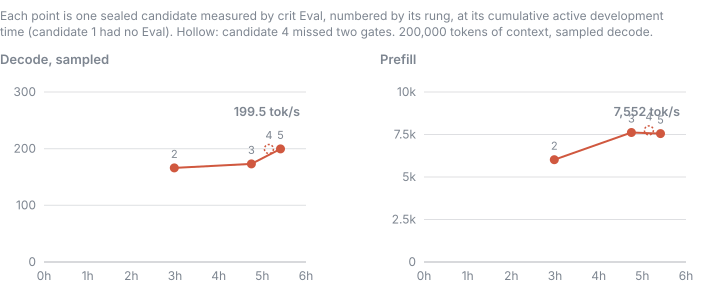
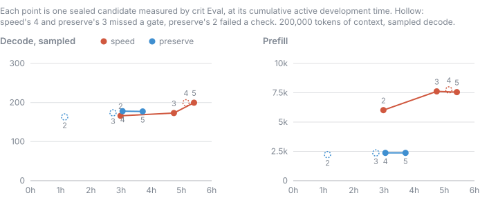
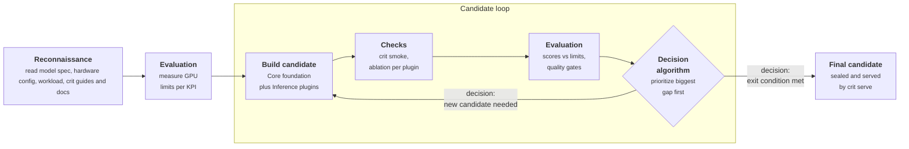

<!-- mcp-name: io.github.crit-labs/crit (the MCP Registry reads this line: mcp/server.json) -->
<div align="center">

<h1 align="center">
  <br />
  crit
</h1>

---

### Agentic toolkit for building and optimizing high-performance inference engines tailored to your GPU and desired LLM.

<p align="center">
  <a href="https://github.com/crit-labs/crit#documentation"></a>
  <a href="https://crit-hub.dev"></a>
  <a href="https://huggingface.co/crit-labs"></a>
  <a href="https://github.com/crit-labs/crit/releases"></a>
  <a href="https://github.com/crit-labs/crit/blob/main/LICENSE"></a>
</p>

[Summary](#summary) • [Quick start](#quick-start) • [What `crit` solves](#what-crit-solves) • [Case studies](#case-study) •
[How `crit` works](#how-crit-works) • [API](#api) • [CLI](#cli) • [MCP](#mcp) • [crit-hub](#crit-hub) • [Limitations](#limitations) • [Documentation](#documentation)

</div>

---

<a id="summary"></a>

## Summary

**Your coding agent builds the engine; `crit` gives it the runtime, the techniques, the kernels and the measurements.**
> [!IMPORTANT]
> Combines a runtime foundation, reusable techniques as plugins, its own kernels built and tuned for your GPU
> and physics-based evaluation. 
>
> In our latest case study, a coding agent built an engine for Qwen3.8-27B on one RTX 5090 in 5h 28m of active work and
> five candidates, reaching 199.5 tok/s sampled decode and 7,552 tok/s prefill with 200,000 tokens of context.
> 
> Give your coding agent the [agent instructions](https://github.com/crit-labs/crit/blob/main/AGENTS.md), target model and
> hardware. crit is an agent toolkit: its records, checks and guides are written for an agent driving it.

---

<a id="quick-start"></a>

## Quick start

Give one of these prompts to your coding agent and specify your target LLM or target engine:
```bash
Use github.com/crit-labs/crit to build an optimized inference engine for <huggingface_url>.
```

```bash
Use github.com/crit-labs/crit to optimize my own inference engine in <engine_reference>.
```

---

<a id="what-crit-solves"></a>

## What `crit` solves

**The boring stuff has already been built ⏱️** 
> Requests, memory management and cleanup
> eat up development time before optimization even starts. `crit` supplies a clean
> foundation so you can get to the work that makes your engine fast.

**Curated high-impact inference strategies 📊** 
> Don't rebuild inference strategies from scratch. We studied established
> inference engines and distilled their core speedup strategies into reusable code, so you can
> apply what works to your model and hardware quickly. Each strategy is a plugin with its own tests,
> and an ablation switches each one off to measure what it adds to your engine.

**Physics-based evaluation suite 🔬** 
> A benchmark score alone doesn't tell
> you what's still left on the table. `crit` measures your hardware's limits and shows
> how close your engine gets, with quality and correctness checks along the way.

---

<a id="case-study"></a>

## Case Studies

> [!NOTE]
> Both engines of these case studies are plugin packages built with crit's plugin architecture, on crit's main after
> 0.18.0, and are on [`crit-hub`](https://github.com/crit-labs/crit-hub) as
> [`crit-labs/mtp5-nvfp4-drafts`](https://github.com/crit-labs/crit-hub/tree/main/engines/crit-labs/mtp5-nvfp4-drafts) and
> [`crit-labs/mtp3-exact-prompt-rows`](https://github.com/crit-labs/crit-hub/tree/main/engines/crit-labs/mtp3-exact-prompt-rows).

We gave `Claude Opus 5.5` a target LLM along with the `crit` repository and let it cook autonomously.

| What it shows | Evidence |
| --- | --- |
| **Fast engines** | Qwen3.8-27B on one RTX 5090: 199.5 tok/s sampled decode and 7,552 tok/s prefill with 200,000 tokens of context, +20% decode and +26% prefill over its first Eval-measured candidate |
| **Quality is your call** | The same model built once per quality mode: `speed` prefills 3.2x faster and decodes 13% faster, `preserve` drifts a fifth as far from the checkpoint (mean KL divergence 0.018 against 0.087) |
| **Hours, not weeks** | 5h 28m of active development and five candidates from the run's first command to the selected engine, $34 at API list prices |
| **New architectures** | crit had no model plugin for Qwen3.8's hybrid gated-delta layout; each agent wrote its own and ran it on crit's library plugins |
| **Every step is evidence** | Each candidate is sealed with its exact source and its Eval result, so the tables below are a record, not a recollection |
| **Honest about what is left** | Decode runs at 65% of the ceiling Eval measures for it, prefill at 43%; Eval reports each gap next to the score |
| **Next** | Gemma 4 31B (dense), and Qwen3.8-Flash-Next and Nemotron 3.5 Super 120B, mixture-of-experts models larger than VRAM |

<details>
<summary><strong>Dev box details</strong></summary>

| Part | Spec |
| --- | --- |
| GPU | NVIDIA GeForce RTX 5090, 32 GB, 450 W power limit |
| PCIe | Gen 4 x16 (the card supports Gen 5; the board's slot is Gen 4) |
| CPU | AMD Ryzen 5 9600, 6 cores, 12 threads |
| RAM | 96 GB DDR5 (2x 48 GB) at 4,800 MT/s |
| OS | Windows 11 Home (build 26200), engines run in WSL 2 on Ubuntu 24.04 |
| Driver and CUDA | NVIDIA driver 596.49 (CUDA 13.2), CUDA toolkit 13.1 |

</details>

---

<details>
<summary><strong>📋 Dense LLM, Qwen architecture</strong></summary>

<br />

**Goal:** Get to a fast, working engine for a dense model as quickly as possible.
**Limit:** A fixed candidate budget.

<div align="center">
<table>
  <tr>
    <td align="center" width="16%">
      <strong>

5h 28m</strong>

Development time
    </td>
    <td align="center" width="16%">
      <strong>

199.5 tok/s</strong>

Sampled decode
    </td>
    <td align="center" width="16%">
      <strong>

7,552 tok/s</strong>

Prefill
    </td>
    <td align="center" width="16%">
      <strong>

204 ms</strong>

TTFT
    </td>
    <td align="center" width="16%">
      <strong>

+0.8%</strong>

Perplexity vs reference
    </td>
    <td align="center" width="16%">
      <strong>

0.087</strong>

Mean KL divergence
    </td>
  </tr>
</table>
</div>

<br />

`mtp5-nvfp4-drafts`
runs Qwen3.8-27B in its stored NVFP4 and FP8 weights on one RTX 5090 with 200,000 tokens of context, in the
`speed` quality mode: the engine may trade drift from the checkpoint for speed within a budget that only keeps
out a broken engine. One coding agent built it from `crit` and `crit-eval` alone, as a plugin package: crit's
library plugins for the projections (the stored 4-bit and 8-bit weights on crit's prompt GEMM and decode GEMV
kernels), FP8 attention pages, the gated-delta recurrence, fused norms and token sampling, plus a model plugin it
wrote for the checkpoint's architecture, which crit's library did not have. Each round drafts 5 tokens with the
model's own MTP layer inside Core's captured rounds, from NVFP4 copies of that layer and of the output head that
only the drafter reads; the verify pass keeps the stored weights and samples with rejection sampling on the
GPU, so sampled requests draft too. Prompts run the gated-delta layers as chunked tensor-core scans.

<p align="center">
  
</p>

| Candidate | What changed | Sampled decode | Prefill | TTFT | Dev time, cumulative | Agent tokens, cumulative | API equivalent, cumulative |
| --- | --- | ---: | ---: | ---: | ---: | ---: | ---: |
| 1 | Working engine: its own model plugin on crit's library plugins, drafting 3 tokens with the model's MTP layer in captured rounds (two drafts before it failed checks: short prompt chunks took decode arithmetic, then short prompts' first tokens jittered) | – | – | – | 0h 59m | 41.4M | $12.60 |
| 2 | Plugin round: the ablation kept fused norms (+14% decode) and an NVFP4 copy of the MTP layer (+4%); six other library plugins measured neutral and were dropped | 166 tok/s | 6,015 tok/s | 264 ms | 2h 59m | 61.9M | $21.83 |
| 3 | Chunked tensor-core recurrence for prompts, an NVFP4 copy of the output head for drafting (a draft with crit's native prompt GEMMs failed smoke: it broke causality at 100 to 255 rows) | 173 tok/s | 7,620 tok/s | 202 ms | 4h 45m | 77.2M | $29.75 |
| 4 | Drafts 5 tokens a round, 4,096-token prompt chunks (missed two gates: no device memory left after the long-context curve, one Japanese prompt in generality) | 199 tok/s | 7,742 tok/s | 198 ms | 5h 09m | 85.4M | $31.91 |
| **5** | **2,048-token prompt chunks again for memory headroom; certified, every gate passed** | **199.5 tok/s** | **7,552 tok/s** | **204 ms** | **5h 28m** | **93.9M** | **$33.98** |

Each rung's first candidate seals its source and code; a draft that fails a check is fixed as a new candidate of
the same rung, so the run sealed nine candidates on five rungs. Candidate 1 had no Eval, which the first rung
skips. The last three columns are running totals from the run's first command to each rung's last seal, and for
candidate 5 to the run's stop, so its row is the whole run. Development time counts only the time the build was
active: the agent working, or a job it started running while its session was up. The session went offline twice
overnight, from 02:32 to 05:18 and from 06:24 to 07:39 UTC, and those 4h 01m are left out, so the 9h 28m from the
first command to the stop count as 5h 28m. (Kernel sweeps the agent started before the first stretch kept running
in it, but nobody was there to use them, and their tuning later measured neutral.) Candidate 2 was sealed after
the first stretch; its Eval had finished at 1h 50m. Agent tokens and API equivalent count the agent's messages in
that span, from its Claude Code session transcript (`crit run cost`): Claude Opus 5.5 for every message, priced at
Anthropic's API list prices ($4/MTok input, $20/MTok output, $8/MTok 1-hour cache writes, $0.20/MTok cache reads;
98% of the tokens are cache reads).

Measured with `crit-eval` (crit-eval-v0.6.0) at 200,000 tokens of context. Decode is sampled at the model's own
settings (temperature 1.0, top-p 0.95, top-k 20), the geometric mean over Eval's speed cases; Eval decodes each
engine's own output.

- **Long context:** decode runs at 172 tok/s at 32K tokens and 110 tok/s at 200,000; a prompt that fills all
  200,000 tokens gets its first token after 100 s. On held-out prompts in 10 languages it decodes at 135 tok/s.
- **Quality:** the worst path uses 44% of the `speed` drift budget. Greedy decoding reaches 220 tok/s, and
  drafting never changes the output: it is token for token what plain greedy decoding produces.
- **Concurrency:** four clients together reach 250 tok/s. Each row runs its full 5-token draft chain, so that is
  less than the 325 tok/s of candidate 2, which drafted 3.
- **What is left:** a verify pass takes 42.9 ms against the 13.8 ms its weight reads need. The NVFP4 prompt GEMMs
  run at about 40% of the GPU's FP4 rate on every GEMM structure crit offers, and the long-context prompt reader
  takes 100 s at 200,000 tokens against a 26 s floor.

</details>

---

<details>
<summary><strong>📋 Quality modes comparison</strong></summary>

<br />

**Goal:** Show what each quality mode buys, on the same model, GPU and agent.
**Limit:** Five candidates per run.

`crit` judges an engine's quality in one of two modes, chosen per run: how much output drift from the
checkpoint you select the engine may trade for speed, whatever format that checkpoint is stored in.
`speed`, the default: the engine picks its precision (4-bit and 8-bit
activations, a lower-precision KV cache or head) within a budget that only keeps out a broken engine
(mean KLD 0.4), and output differences that part at near-ties are allowed. `preserve` holds the output
close to the checkpoint's, within a 5% drift budget (mean KLD 0.05), so the prompt's activations stay in 16 bits,
and a served reply must score exactly as the same text scored as a prompt. Both modes judge against the same
exact reference. We built Qwen3.8-27B on one RTX 5090 once in each mode, each from `crit` and `crit-eval` alone:
`mtp5-nvfp4-drafts` from the case study above, and `mtp3-exact-prompt-rows`, which drafts 3 tokens a round from
FP8 copies of the MTP layer's matrices and an NVFP4 copy of the output head, and runs prompt rows on the decode
kernels' 16-bit arithmetic so that a prompt's tokens score exactly as the same tokens decoded.

<p align="center">
  
</p>

| | `speed` | `preserve` |
| --- | ---: | ---: |
| Sampled decode | **199.5 tok/s** | 177.2 tok/s |
| Greedy decode | **219.7 tok/s** | 186.7 tok/s |
| Prefill | **7,552 tok/s** | 2,371 tok/s |
| TTFT | **204 ms** | 423 ms |
| Decode at 200,000 tokens of context | 110 tok/s | **114 tok/s** |
| Four clients together | 250 tok/s | **310 tok/s** |
| Perplexity vs reference | +0.8% | **+0.6%** |
| Mean KL divergence, worst path | 0.087 | **0.018** |
| Share of its mode's drift budget | 44% | 37% |
| Development time, five candidates | 5h 28m | **3h 44m** |
| API equivalent | $33.98 | **$29.99** |

- **Prefill is where the modes split.** A long prompt is compute-bound. `speed` feeds 4-bit activations to the
  GPU's 4-bit tensor cores, as the checkpoint declares; `preserve` must sum a prompt row exactly like a decode row,
  so its prompts run on the decode kernels' 16-bit arithmetic. Eval prices each mode's ceiling accordingly:
  `speed` reaches 43% of its 17,577 tok/s, `preserve` 47% of the 5,018 tok/s that arithmetic allows.
- **Decode is close.** A decode pass reads every weight once, and both engines read the same stored 4-bit and
  8-bit weights. `speed` is 13% faster because it drafts 5 tokens a round from NVFP4 copies; `preserve` measured
  widths 2, 4 and 5 and kept 3. At 200,000 tokens and with four clients, `preserve`'s shorter chains come out ahead.
- **Quality follows the mode.** Both stay within 1% of the checkpoint's perplexity, but `preserve` drifts a fifth
  as far by KL divergence, and its served replies score exactly as the same text scored as a prompt.
- **Both runs were honest about failures.** `preserve`'s candidate 2 was sealed not qualified because its model
  plugin's own test lacked an MTP layer, and candidate 3 left no device memory after the long-context curve, as did
  `speed`'s candidate 4. Each fix became the next candidate.

Pick `preserve` when answers must stay close to the checkpoint you selected; keep `speed`, the
default, when speed matters more, as with agents that send long prompts.

| `preserve` candidate | What changed | Sampled decode | Prefill | TTFT | Dev time, cumulative | Agent tokens, cumulative | API equivalent, cumulative |
| --- | --- | ---: | ---: | ---: | ---: | ---: | ---: |
| 1 | Working engine: its own model plugin on crit's library plugins, the stored 4-bit and 8-bit weights with 16-bit activations, Core's captured rounds, no drafting (about 67 tok/s in process) | – | – | – | 0h 30m | 40.3M | $12.84 |
| 2 | Drafts 3 tokens a round with the model's MTP layer, from FP8 copies of its matrices (sealed not qualified: the model plugin's own test lacked an MTP layer) | 163 tok/s | 2,226 tok/s | 521 ms | 1h 08m | 55.2M | $16.55 |
| 3 | Captured prompt chunks, kernel tuning for the engine's shapes, neutral plugins pruned, the test fixed (missed the resources gate: no device memory left after the long-context curve) | 174 tok/s | 2,363 tok/s | 425 ms | 2h 44m | 86.0M | $24.27 |
| 4 | An NVFP4 copy of the output head for drafting, in 8 row slices; cached memory released after long prompts | 178 tok/s | 2,370 tok/s | 497 ms | 3h 03m | 94.0M | $26.23 |
| **5** | **FP8 KV pages for the MTP layer; certified, every gate passed** | **177 tok/s** | **2,371 tok/s** | **423 ms** | **3h 44m** | **108.3M** | **$29.99** |

Measured like the case study above. The `preserve` run had no idle stretch: every pause of more than a few minutes
in its transcript ended with a job it had started, so its 3h 44m is the whole run from first command to stop.

</details>

---

<a id="how-crit-works"></a>

## How `crit` works

An agent builds the engine as a series of candidates. Each candidate is a complete,
servable engine, measured the same way, and each next one is chosen from the last one's numbers.
A candidate is assembled from [plugins](https://github.com/crit-labs/crit/blob/main/docs/PLUGINS.md), one per slot (attention, KV cache, drafter, ...).
Before Eval measures it, [crit smoke](https://github.com/crit-labs/crit/blob/main/smoke/README.md) checks its quality paths in minutes, and an ablation
serves it with each plugin switched off and alone to show what each one adds, costs or breaks.



> [!NOTE]
> Every step is recorded through the [CLI](https://github.com/crit-labs/crit/blob/main/cli/README.md): each candidate freezes its source by hash,
> each measurement points at that exact package, and the run's cost is counted from the agent's own
> transcripts ([run records](https://github.com/crit-labs/crit/blob/main/docs/RUN_RECORDS.md)).

---

<a id="core"></a>

<details>
<summary><strong>📗 Core</strong> → <a href="core/README.md">Full guide</a></summary>

<br />

**Core is the plumbing every engine needs, distilled by studying multiple inference engines.**

We took apart how each engine handles requests, memory, text and model files, kept the base
features they all rebuild, and turned them into one native SDK. Your engine keeps what makes it
fast: the model, its kernels, its layouts and its execution strategy.

| Part | What it does |
| --- | --- |
| [Runtime](https://github.com/crit-labs/crit/blob/main/core/src/runtime/README.md) | Admits, schedules, cancels and retires requests, and publishes their output |
| [Engine ABI](https://github.com/crit-labs/crit/blob/main/core/src/runtime/README.md#engine-abi) | Core's engine C ABI, which `crit_core_steps` exports for the engines Core's loader assembles |
| [Memory](https://github.com/crit-labs/crit/blob/main/core/src/memory/README.md) | Resource budgets, reservations and host-memory admission |
| [Text](https://github.com/crit-labs/crit/blob/main/core/python/crit_core/text/README.md) | Tokenizer and chat template loading, stop strings and streamed reply text |
| [Sampling](https://github.com/crit-labs/crit/blob/main/core/src/sampling/README.md) | Sampling rules, penalties, log-probabilities and greedy draft acceptance |
| [State cache](https://github.com/crit-labs/crit/blob/main/core/src/state/README.md) | KV pages, recurrent state slots and prefix-cache snapshots |
| [Model files](https://github.com/crit-labs/crit/blob/main/core/python/crit_core/model/README.md) | Safetensors and GGUF checkpoints, `config.json`, generation defaults and stop tokens |
| [Files](https://github.com/crit-labs/crit/blob/main/core/src/io/README.md) | Strict JSON, read-only, chunked and mapped file reads, SHA-256 |
| [Structured output](https://github.com/crit-labs/crit/blob/main/core/src/constraints/README.md) | Token masks for choices, JSON schemas and grammars |
| [Device graphs](https://github.com/crit-labs/crit/blob/main/core/src/backends/cuda/README.md#graph-capture) | CUDA graph capture and replay to cut launch overhead |
| [CUDA backend](https://github.com/crit-labs/crit/blob/main/core/src/backends/cuda/README.md) | Allocations, streams, shared device memory and device time per category |
| [Tracing](https://github.com/crit-labs/crit/blob/main/core/src/runtime/README.md#lifecycle-tracing) | A bounded lifecycle trace with operator ranges and NVTX |
| [Contracts](https://github.com/crit-labs/crit/blob/main/core/contracts/README.md) | Who owns what between Core and your engine |
| [Plugins](https://github.com/crit-labs/crit/blob/main/docs/PLUGINS.md) | Slots and their interfaces, plugin manifests and the checked assembly an engine built from plugins loads with |

Try the [plugin engine walkthrough](https://github.com/crit-labs/crit/blob/main/inference/examples/plugin-engine/README.md).

</details>

---

<a id="inference"></a>

<details>
<summary><strong>📕 Inference</strong> → <a href="inference/README.md">Full guide</a></summary>

<br />

**Inference is a curated collection of high-performance strategies.**

We studied bespoke inference engines and what makes them fast and turned every strategy that holds beyond one model or
GPU into an entry. Your agent picks the entries that match its engine's bottleneck and builds them
into the engine on Core, each in its slot as a plugin.

**Examples**:

| Bottleneck | Example entries |
| --- | --- |
| One token per pass | [Speculative decoding](https://github.com/crit-labs/crit/blob/main/inference/mtp-decode/README.md), [draft trees](https://github.com/crit-labs/crit/blob/main/inference/draft-trees/README.md), [device-side rounds](https://github.com/crit-labs/crit/blob/main/inference/device-speculative-round/README.md), [EAGLE-3 and DFlash drafters](https://github.com/crit-labs/crit/blob/main/inference/hidden-state-drafters/README.md) |
| Weight bytes per pass | [Quantized projections](https://github.com/crit-labs/crit/blob/main/inference/quantized-projections/README.md), on crit's GEMM and GEMV [kernels](https://github.com/crit-labs/crit/blob/main/kernels/README.md) |
| Long context | [Attention state](https://github.com/crit-labs/crit/blob/main/inference/attention-state/README.md), [prefix checkpoints](https://github.com/crit-labs/crit/blob/main/inference/checkpoint-storage/README.md), [session scheduling](https://github.com/crit-labs/crit/blob/main/inference/session-scheduling/README.md) |
| Model larger than VRAM | Recon names the placement scenario. Sparse models: a [device expert cache](https://github.com/crit-labs/crit/blob/main/inference/device-expert-cache/README.md) with [expert residency](https://github.com/crit-labs/crit/blob/main/inference/expert-residency/README.md) and the checkpoint's drafter from the first candidate, misses [computed on the CPU](https://github.com/crit-labs/crit/blob/main/inference/host-expert-arithmetic/README.md) or copied by [measured dispatch](https://github.com/crit-labs/crit/blob/main/inference/heterogeneous-expert-dispatch/README.md); dense models: [dense layer offload](https://github.com/crit-labs/crit/blob/main/inference/dense-layer-offload/README.md) |
| Embedding and n-gram tables | [Lookup table rows](https://github.com/crit-labs/crit/blob/main/inference/lookup-table-rows/README.md): rows read on demand from disk, no read-ahead |
| Hybrid recurrent layers | [Recurrent state recovery](https://github.com/crit-labs/crit/blob/main/inference/recurrent-state-recovery/README.md) |

All entries are in the [full guide](https://github.com/crit-labs/crit/blob/main/inference/README.md), or run `crit inference search <query>`.

**Every entry has the same layout:**

| Part | What it holds |
| --- | --- |
| `README.md` | When to use it, how it works, a worked example, how to adapt it, its costs and how to validate it |
| `code/` | Real implementation code, C++, CUDA or Python, with runnable examples |
| `entry.json` | When to use and avoid it, what the code provides, what the engine must supply and what it must preserve |
| `plugin.json`, `plugin.py`, `tests/` | For an entry that fills an engine slot: the entry as a [plugin](https://github.com/crit-labs/crit/blob/main/docs/PLUGINS.md), a host reference with tests against the slot's base plugin, which `crit plugins add` copies into an engine |

**What gets in: [contribution criteria](https://github.com/crit-labs/crit/blob/main/docs/CONTRIBUTION_CRITERIA.md)**

| Criterion | Means |
| --- | --- |
| Shown value | A measured gain, a reproduced and fixed bug, or a capability engines had to rebuild themselves |
| No overfitting | Nothing in it is true only for the model or GPU where it was found |
| Broad use | Dense, MoE, hybrid and multimodal models and other GPUs and backends use it unchanged or are unaffected |

</details>

---

<a id="kernels"></a>

<details>
<summary><strong>📘 Kernels</strong> → <a href="kernels/README.md">Full guide</a></summary>

<br />

**crit ships its own GPU kernels, built and tuned on your machine for your GPU and model.**

crit's kernels cover the operations that decide an engine's speed: projections, attention, recurrent scans, experts
and norms. Each one is a template built from a shared kernel core; `crit kernels sweep` tunes its knobs on the
model's own shapes, checks every configuration against an FP64 reference and times it against the best library.
Nothing is downloaded or shipped prebuilt. Wherever one of these kernels covers an operation, your agent uses it.

<a id="kernels-list"></a>

| Family | Kernels |
| --- | --- |
| Projections | [decode-gemv](https://github.com/crit-labs/crit/blob/main/kernels/techniques/projections/decode-gemv/README.md), [mma-rows](https://github.com/crit-labs/crit/blob/main/kernels/techniques/projections/mma-rows/README.md), [pinned-gemm](https://github.com/crit-labs/crit/blob/main/kernels/techniques/projections/pinned-gemm/README.md), [fixed-tile-gemm](https://github.com/crit-labs/crit/blob/main/kernels/techniques/projections/fixed-tile-gemm/README.md), [fp8-block-rows](https://github.com/crit-labs/crit/blob/main/kernels/techniques/projections/fp8-block-rows/README.md) |
| Attention | [paged-kv-attention](https://github.com/crit-labs/crit/blob/main/kernels/techniques/attention/paged-kv-attention/README.md) |
| Recurrence | [recurrent-scans](https://github.com/crit-labs/crit/blob/main/kernels/techniques/recurrence/recurrent-scans/README.md) |
| Experts | [grouped-experts](https://github.com/crit-labs/crit/blob/main/kernels/techniques/experts/grouped-experts/README.md), [int-block-experts](https://github.com/crit-labs/crit/blob/main/kernels/techniques/experts/int-block-experts/README.md), [topk-routing](https://github.com/crit-labs/crit/blob/main/kernels/techniques/experts/topk-routing/README.md) |
| Norms | [fused-norms](https://github.com/crit-labs/crit/blob/main/kernels/techniques/norms/fused-norms/README.md) |

**Every kernel has the same layout:**

| Part | What it holds |
| --- | --- |
| `kernel.json` | Operations, sources, GPU architectures, structures, knobs and the library yardstick |
| `bench.py` | The sweep's shapes, inputs, reference check and timing |
| `torch-ext/`, `<id>_cuda/` | The kernel's Triton and CUDA source, built from [the kernel core](https://github.com/crit-labs/crit/blob/main/kernels/core/README.md) |
| `tests/`, `README.md` | Tests against the FP64 reference; design, measured speed against the yardstick, what is left |

<a id="kernels-libraries"></a>

**If no crit kernel covers an operation, your agent takes it from one of these libraries:**

| Library | Covers |
| --- | --- |
| [Hugging Face Kernel Hub](https://huggingface.co/kernels) | Community kernels for attention, GEMMs, activations, normalization, MoE and more, built per framework version and backend (CUDA, ROCm, Metal, XPU, CPU) |
| [cuBLASLt](https://docs.nvidia.com/cuda/cublas/#using-the-cublaslt-api) | GEMMs in BF16/FP16, FP8 (per-tensor and per-row scales), block-scaled NVFP4 and MXFP8 on the GPUs that have them; epilogues |
| [CUTLASS](https://github.com/NVIDIA/cutlass) | GEMM and convolution templates for layouts and fusions cuBLASLt does not take, grouped GEMMs, mixed-input GEMMs |
| [cuDNN](https://docs.nvidia.com/deeplearning/cudnn/) | Fused attention (SDPA), normalization |
| [FlashAttention](https://github.com/Dao-AILab/flash-attention) | Prompt and decode attention, paged KV, sliding windows, softcap |
| [FlashInfer](https://github.com/flashinfer-ai/flashinfer) | Paged and ragged attention, FP8 KV, MLA, cascade attention, top-k / top-p / min-p sampling, some GEMMs |
| [flash-linear-attention](https://github.com/fla-org/flash-linear-attention) | Chunked prefill and recurrent decode for gated delta, Mamba-style, RWKV and other linear attention |
| [Marlin](https://github.com/IST-DASLab/marlin) | Mixed-input GEMMs: 4-bit weights (GPTQ-style groups) against 16-bit activations |
| [ggml](https://github.com/ggml-org/ggml) | GGUF block formats (Q4_0 .. Q8_0, K-quants, IQ) on CUDA, Metal, Vulkan, ROCm and CPU |
| [OpenBLAS](https://github.com/OpenMathLib/OpenBLAS), oneDNN | CPU GEMMs and fused CPU operators |
| [Composable Kernel](https://github.com/ROCm/composable_kernel), [hipBLASLt](https://github.com/ROCm/hipBLASLt) | GEMMs and attention on AMD GPUs |
| [MLX](https://github.com/ml-explore/mlx), Metal Performance Shaders | GEMMs, attention and quantized matmuls on Apple GPUs |

**If no library fits either, your agent builds the kernel itself** in the
[kernel workbench](https://github.com/crit-labs/crit/blob/main/kernels/README.md#write-or-adapt-a-kernel-the-workbench):
`crit kernels new` scaffolds a folder with the checkpoint's own shapes, an FP64 reference and a library yardstick,
and `crit eval workbench check`, `bench` and `profile` check it, time it and break it down. A kernel that holds
beyond one model and GPU is a welcome contribution as a crit kernel.

</details>

---

<a id="eval"></a>

<details>
<summary><strong>📚 Eval</strong> → <a href="https://github.com/crit-labs/crit-eval">Full guide</a></summary>

<br />

[`crit-eval`](https://github.com/crit-labs/crit-eval) is a speed and quality measurement tool to compare inference engines honestly.

**There is no shared way to measure a bespoke inference engine.**
> Different bespoke inference engines report vastly different types of numbers. An honest comparison requires
> downloading and running the engines yourself. `crit-eval` finally makes apples-to-apples comparison possible.

**Physics-based evaluation lets you see what performance is left on the table.**
> `crit-eval` measures your GPU's memory bandwidth and matrix-multiply rates and turns them into a limit for each
> score. Its evaluation report can tell your coding agent how much performance can still be squeezed out of your
> inference engine.

**Speed that can't hide a quality loss.**
> Many inference engines push decode and prefill speed with no regard for quality. `crit-eval` treats quality
> as a first-class KPI. It measures not only inference speed but also quality regressions.

**A hardware report rounds out the evaluation.**
> The same model on the same inference engine but on two different machines can also lead to different inference
> speeds, even if the GPU is the same. We make this transparent by also reporting the runner's hardware configuration.

</details>

---

<a id="api"></a>
<a id="serving"></a>

<details>
<summary><strong>🔌 API</strong> → <a href="api/README.md">Overview</a> · <a href="docs/SERVING.md">Full guide</a></summary>

<br />

`crit serve` loads a sealed candidate, keeps it resident and answers OpenAI-compatible
chat requests, including streaming, tool calls, stop strings and structured output. The same engine
also speaks the [Anthropic Messages, OpenAI Responses and `/api/chat` APIs](https://github.com/crit-labs/crit/blob/main/docs/SERVING.md#other-api-dialects),
so Claude Code, Codex and local chat UIs need only a base URL, and `GET /metrics` serves
[Prometheus metrics](https://github.com/crit-labs/crit/blob/main/docs/SERVING.md#metrics). Eval measures every candidate through this same
server, so the numbers you read are the numbers you get. Engines implement the
[Core's resident adapter](https://github.com/crit-labs/crit/blob/main/docs/SERVING.md#cores-resident-adapter).

</details>

---

<a id="cli"></a>

<details>
<summary><strong>📓 CLI</strong> → <a href="cli/README.md">Overview</a></summary>

<br />

One `crit` command drives everything: `crit run` keeps the run's records (plans, candidates,
measurements, ablations, selection, cost), `crit eval` runs the common suite, `crit smoke` checks a served
engine in minutes, `crit plugins` checks and tests an engine's plugins, `crit serve` serves an engine,
`crit pull` installs a crit-hub engine, `crit bench` and `crit hub report` measure it on your machine and add the
result to its card, and `crit kernels`, `crit models` and `crit inference` reach the other parts. Records are written only
through it, so each plan, candidate, Eval and seal is checked as it is recorded.

</details>

---

<a id="mcp"></a>

<details>
<summary><strong>🧩 MCP</strong> → <a href="mcp/README.md">Full guide</a></summary>

<br />

`crit mcp` offers crit's command line to an agent as [MCP](https://modelcontextprotocol.io) tools, so an agent whose
harness speaks MCP (Claude Code, Codex, Cline and most others) drives a run through typed tools instead of shell
commands, and waits on builds and Eval through jobs the server owns.

```bash
claude mcp add crit -- crit mcp --root /path/to/runs
```

| Tool | What it does |
| --- | --- |
| `crit_run_*` | A run's records: next, create, plan, candidate, build, package, eval, serve, seal, ... |
| `crit_eval_*` | crit Eval: probe, prepare, reference, run, status, kernels, workbench, ab, ... |
| `crit_kernels_*` | List, build and sweep crit's kernels; scaffold a workbench |
| `crit_models_*`, `crit_inference_*` | Weight transforms and drafters; the Inference techniques |
| `crit_pull`, `crit_serve`, `crit_serve_status` | Install a crit-hub engine, serve it, check a running server |
| `crit_job_*`, `crit_jobs` | Wait on, read and stop the commands' jobs |

Every tool's inputs come from the command's own parser, and its annotations mark it read-only, destructive or
open-world, so a client can run the read-only ones without asking. See the [full guide](https://github.com/crit-labs/crit/blob/main/mcp/README.md) for hosts, jobs and
privacy.

</details>

---

## Miscellaneous

---

<a id="crit-hub"></a>

<details>
<summary><strong>🔭 crit-hub</strong> → <a href="https://github.com/crit-labs/crit-hub">Repository</a></summary>

<br />

[`crit-hub`](https://github.com/crit-labs/crit-hub) collects bespoke inference engines in one repository 
to make discovery super easy. Each engine pins its runnable source, the exact checkpoint it was built on, what 
was measured, its known limits and a link to the repository of whoever contributed it. 
Use them as jump-off point for further optimization.

`crit pull OWNER/NAME` installs one: it checks the card's requirements against your GPU and CUDA,
fetches the source at its pinned commit, builds it, fetches and checks the checkpoint, and then
`crit serve --engine OWNER/NAME` serves it ([Installed engines](https://github.com/crit-labs/crit/blob/main/docs/SERVING.md#installed-engines)).
`crit bench` measures it on your machine beside its card's numbers, and `crit hub report` adds your result to the
card for a pull request ([Benchmark your machine](https://github.com/crit-labs/crit/blob/main/docs/SERVING.md#benchmark-your-machine)).

</details>

---

<a id="limitations"></a>

<details>
<summary><strong>🚫 Limitations</strong></summary>

<br />

| Area | Current status |
| --- | --- |
| Multi-GPU setups | Core's device sets (peer access, copies, ordering, barrier), `crit eval probe --devices` and Eval's floors for weights split across GPUs are in; partitioning and collectives are the engine's. Tested on one GPU only, not end to end on two. |
| macOS | Not yet tested. Current CI covers Windows and Linux. |
| AMD and Apple GPUs | No bundled ROCm or Metal backend. The current GPU backend uses CUDA. |
| Model formats | Hugging Face safetensors, PyTorch state dicts (`.bin`, `.pt`) and Optimum ONNX exports, unquantized or [quantized](https://github.com/crit-labs/crit-eval/blob/main/docs/README.md#other-weight-formats-and-quantization-schemes) as FP8, NVFP4, compressed-tensors int, AWQ, GPTQ, MLX, bitsandbytes or MatMulNBits, and [GGUF](https://github.com/crit-labs/crit-eval/blob/main/docs/README.md#gguf-models), a lone `.gguf` included: its config, tokenizer and chat template are derived from its metadata for the `llama`, `qwen2`, `qwen3`, `qwen3moe`, `qwen35`, `qwen35moe`, `deepseek4` and `qwen4exp` architectures (the config by the rules crit Eval gives Core) and byte-level BPE tokenizers (others need the base model's files beside it), and Eval's reference reads those architectures. A new format is one `ModelFormat` in `crit_core.model`. Core's C++ model library reads safetensors only; engines read a GGUF's tensors through `crit_core.model`'s offsets. |

</details>

---

<a id="documentation"></a>

## Documentation

| To… | Read |
| --- | --- |
| Build and compare engines | [Building engines](https://github.com/crit-labs/crit/blob/main/docs/BUILDING_ENGINES.md) · [Agent instructions](https://github.com/crit-labs/crit/blob/main/AGENTS.md) · [Run records](https://github.com/crit-labs/crit/blob/main/docs/RUN_RECORDS.md) |
| Integrate the native runtime | [Core](https://github.com/crit-labs/crit/blob/main/core/README.md) · [Contracts](https://github.com/crit-labs/crit/blob/main/core/contracts/README.md) · [Plugin engine walkthrough](https://github.com/crit-labs/crit/blob/main/inference/examples/plugin-engine/README.md) |
| Choose or adapt a technique | [Inference](https://github.com/crit-labs/crit/blob/main/inference/README.md) |
| Build an engine from plugins and measure each one | [Plugins](https://github.com/crit-labs/crit/blob/main/docs/PLUGINS.md) · [Smoke tests](https://github.com/crit-labs/crit/blob/main/smoke/README.md) |
| Find and adapt kernels | [Kernels](https://github.com/crit-labs/crit/blob/main/kernels/README.md) |
| Quantize weights and record the transform | [Models](https://github.com/crit-labs/crit/blob/main/models/README.md) |
| Compare speed, quality and speculative output | [Eval](https://github.com/crit-labs/crit-eval/blob/main/docs/README.md) |
| Serve an engine through the OpenAI, Anthropic or `/api/chat` API | [API](https://github.com/crit-labs/crit/blob/main/api/README.md) · [Serving](https://github.com/crit-labs/crit/blob/main/docs/SERVING.md) · [Core's resident adapter](https://github.com/crit-labs/crit/blob/main/docs/SERVING.md#cores-resident-adapter) |
| Find a `crit` command | [CLI](https://github.com/crit-labs/crit/blob/main/cli/README.md) |
| Change `crit` or run its tests | [What belongs in crit](https://github.com/crit-labs/crit/blob/main/docs/CONTRIBUTION_CRITERIA.md) · [Contributing](https://github.com/crit-labs/crit/blob/main/docs/CONTRIBUTING.md) · [Licensing](https://github.com/crit-labs/crit/blob/main/docs/LICENSES.md) |
| See release history | [Changelog](https://github.com/crit-labs/crit/blob/main/CHANGELOG.md) |
