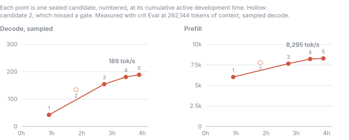
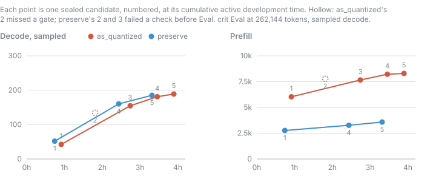
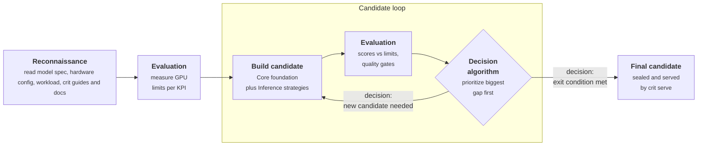

<div align="center">

<p align="center">
  
  
  <br />
</p>

### Why wait for someone to optimize an LLM for your GPU when an AI agent can build a specialized inference engine in a few hours?

[](CHANGELOG.md)
[](LICENSE)
[](https://github.com/crit-labs/crit-hub)
[](https://github.com/crit-labs/crit/actions/workflows/ci.yml)

[Summary](#summary) • [Quick start](#quick-start) • [What `crit` solves](#what-crit-solves) • [Case studies](#case-study) •
[How `crit` works](#how-crit-works) • [API](#api) • [CLI](#cli) • [crit-hub](#crit-hub) • [Limitations](#limitations) • [Documentation](#documentation)

</div>

---

<a id="summary"></a>

## Summary

**`crit` is a toolkit for optimizing or building inference engines tailored to your hardware and desired model.**
> [!IMPORTANT]
> Combines a runtime foundation, reusable techniques, kernel discovery
> and physics-based evaluation. 
>
> In our latest case study, a coding agent built an engine for Qwen3.8-27B on one RTX 5090 in under 4 hours and 
> five candidates, reaching 189 tok/s sampled decode and 8,295 tok/s prefill with the model's full 262,144-token context.
> 
> Follow the [building guide](docs/BUILDING_ENGINES.md) yourself, or give your coding
> agent the [agent instructions](AGENTS.md), target model and hardware.

---

<a id="quick-start"></a>

## Quick start

Give one of these prompts to your coding agent and specify your target LLM or target engine:
```bash
Use github.com/crit-labs/crit to build an optimized inference engine for <huggingface_url>.
```

```bash
Use github.com/crit-labs/crit to optimize my own inference engine in <engine_reference>.
```

---

<a id="what-crit-solves"></a>

## What `crit` solves

**The boring stuff has already been built ⏱️** 
> Requests, memory management and cleanup
> eat up development time before optimization even starts. `crit` supplies a clean
> foundation so you can get to the work that makes your engine fast.

**Curated high-impact inference strategies 📊** 
> Don't rebuild inference strategies from scratch. We studied established
> inference engines and distilled their core speedup strategies into reusable code, so you can
> apply what works to your model and hardware quickly.

**Physics-based evaluation suite 🔬** 
> A benchmark score alone doesn't tell
> you what's still left on the table. `crit` measures your hardware's limits and shows
> how close your engine gets, with quality and correctness checks along the way.

---

<a id="case-study"></a>

## Case Studies

> [!NOTE]
> Find the referenced engines in our [`crit-hub`](https://github.com/crit-labs/crit-hub) repository.

We gave `Claude Opus 5.5` a target LLM along with the `crit` repository and let it cook autonomously.

| What it shows | Evidence |
| --- | --- |
| **Fast engines** | Qwen3.8-27B on one RTX 5090: 189 tok/s sampled decode, 4.4x its own first working candidate, and 8,295 tok/s prefill, with the full 262,144-token context |
| **Quality is your call** | The same model built once per quality mode: `as_quantized` prefills 2.3x faster, `preserve` stays within 0.4% of the exact reference's perplexity, and both decode at the same speed |
| **Hours, not weeks** | 3h 55m and five candidates from the run's first command to the selected engine, $51 at API list prices |
| **Every step is evidence** | Each candidate is sealed with its exact source and its Eval result, so the tables below are a record, not a recollection |
| **Honest about what is left** | Decode runs at 53% of the ceiling Eval measures for it, prefill at 46%; Eval reports each gap next to the score |
| **Next** | Gemma 4 31B (dense), and Qwen3.8-Flash-Next and Nemotron 3.5 Super 120B, mixture-of-experts models larger than VRAM |

<details>
<summary><strong>Dev box details</strong></summary>

| Part | Spec |
| --- | --- |
| GPU | NVIDIA GeForce RTX 5090, 32 GB, 450 W power limit |
| PCIe | Gen 4 x16 (the card supports Gen 5; the board's slot is Gen 4) |
| CPU | AMD Ryzen 5 9600, 6 cores, 12 threads |
| RAM | 96 GB DDR5 (2x 48 GB) at 4,800 MT/s |
| OS | Windows 11 Home (build 26200), engines run in WSL 2 on Ubuntu 24.04 |
| Driver and CUDA | NVIDIA driver 596.49 (CUDA 13.2), CUDA toolkit 13.1 |

</details>

---

<details>
<summary><strong>📋 Dense LLM, Qwen architecture</strong> → <a href="https://github.com/crit-labs/crit-hub/tree/main/engines/crit-labs/mtp4-nvfp4-mma">Inspect engine</a></summary>

<br />

**Goal:** Get to a fast, working engine for a dense model as quickly as possible.
**Limit:** A fixed candidate budget.

<div align="center">
<table>
  <tr>
    <td align="center" width="16%">
      <strong>

3h 55m</strong>

Development time
    </td>
    <td align="center" width="16%">
      <strong>

189.0 tok/s</strong>

Sampled decode
    </td>
    <td align="center" width="16%">
      <strong>

8,295 tok/s</strong>

Prefill
    </td>
    <td align="center" width="16%">
      <strong>

154 ms</strong>

TTFT
    </td>
    <td align="center" width="16%">
      <strong>

+3.6%</strong>

Perplexity vs reference
    </td>
    <td align="center" width="16%">
      <strong>

0.134</strong>

Mean KL divergence
    </td>
  </tr>
</table>
</div>

<br />

[`mtp4-nvfp4-mma`](https://github.com/crit-labs/crit-hub/tree/main/engines/crit-labs/mtp4-nvfp4-mma)
runs Qwen3.8-27B in its original NVFP4 weights on one RTX 5090, with the model's full 262,144
tokens of context, in the `as_quantized` quality mode: Eval judges it against the checkpoint run the
way it was quantized. One coding agent built it on crit's current main as a Python engine on Core:
cuBLASLt for the prompt's 4-bit and 8-bit matrix multiplies, flash-linear-attention for the
gated-delta layers, and its own Triton and CUDA kernels for attention and decode. Each round drafts 4
tokens with the model's own built-in draft layer and verifies them with rejection sampling on the
GPU, so sampled requests draft too. Its own tensor-core NVFP4 GEMV reads the 4-bit weights at
1.2–1.4 TB/s, against 0.9–1.0 TB/s for cuBLASLt at the same shapes.

<p align="center">
  
</p>

| Candidate | What changed | Sampled decode | Prefill | TTFT | Dev time, cumulative | Agent tokens, cumulative | API equivalent, cumulative |
| --- | --- | ---: | ---: | ---: | ---: | ---: | ---: |
| 1 | Working engine: reads the checkpoint as stored, 8-bit KV cache, one CUDA graph per token, no drafting | 43 tok/s | 6,027 tok/s | 290 ms | 0h 55m | 39.2M | $13.96 |
| 2 | Drafts 3 tokens ahead with the model's draft layer, 8-bit decode GEMVs, fused prompt kernels (missed a gate: short prompts reached their first token 12% later at 65,536 tokens of context than at 262,144) | 134 tok/s | 7,771 tok/s | 219 ms | 1h 49m | 69.6M | $23.26 |
| 3 | Drafts 4 tokens ahead; short prompts run as captured CUDA graphs | 155 tok/s | 7,660 tok/s | 169 ms | 2h 44m | 97.7M | $31.51 |
| 4 | Its own tensor-core NVFP4 GEMV for decode and verify, using the GPU's FP4 conversion instruction | 181 tok/s | 8,218 tok/s | 156 ms | 3h 27m | 135.3M | $47.15 |
| **5** | **Drafts from NVFP4 copies of the draft layer and output head; the verify pass keeps the stored weights** | **189 tok/s** | **8,295 tok/s** | **154 ms** | **3h 55m** | **149.3M** | **$50.75** |

The last three columns are running totals from the run's first command (06:28 UTC) to each
candidate's seal, and for candidate 5 to its selection, so its row is the whole run. The run spent
its budget of three candidates on 1 to 3, then resumed for two more; development time leaves out the
3h 26m in between. Candidates 1 to 3 were built from `crit` and `crit-eval` alone; before planning 4 and
5 the agent had read the notes of earlier runs on this model. Agent tokens and API equivalent count
the agent's messages in that span, from its Claude Code session transcript: Claude Opus 5.5 for
every message, priced at Anthropic's API list prices ($4/MTok input, $20/MTok output, $8/MTok 1-hour
cache writes, $0.20/MTok cache reads; 99% of the tokens are cache reads).

Measured with `crit-eval` (crit-eval-v0.2.1) at the full 262,144-token context. Decode is sampled at the
model's own settings (temperature 1.0, top-p 0.95, top-k 20), the geometric mean over six prompts,
from a chat question to a 14K-token agent session; Eval decodes each engine's own output.

- **Long context:** a prompt that fills all 262,144 tokens gets its first token after 144 s, then
  decodes at 110 tok/s. On prompts outside Eval's speed suite, in 8 languages and code, it decodes
  at 131 tok/s.
- **Quality:** the worst path uses 70% of the `as_quantized` drift budget. Greedy decoding reaches
  194 tok/s, and drafting never changes the output: it is token for token what plain decoding produces.
- **What is left:** a verify pass takes 15.1 ms against the 12.5 ms its weight reads need, and a draft
  step 1.24 ms against 0.62 ms. Eval projects 251 tok/s if both reached their floors.

</details>

---

<details>
<summary><strong>📋 Quality modes comparison</strong> → <a href="https://github.com/crit-labs/crit-hub/tree/main/engines/crit-labs/mtp4-nvfp4-mma">as_quantized engine</a> • <a href="https://github.com/crit-labs/crit-hub/tree/main/engines/crit-labs/mtp-adaptive-width">preserve engine</a></summary>

<br />

**Goal:** Show what each quality mode buys, on the same model, GPU and agent.
**Limit:** Five candidates per run.

`crit` judges an engine's quality in one of two modes, chosen per run. `preserve`, the default, holds it
to the checkpoint's own arithmetic with exact activations, within a 5% drift budget: the weights are
used as stored, but the prompt's activations stay in 16 bits unless quality shows they can go lower.
`as_quantized` holds it to the checkpoint run the way it was quantized, with 4-bit and 8-bit
activations where the checkpoint declares them, within a 10% budget. We built Qwen3.8-27B on one RTX
5090 once in each mode: [`mtp4-nvfp4-mma`](https://github.com/crit-labs/crit-hub/tree/main/engines/crit-labs/mtp4-nvfp4-mma)
from the case study above, and
[`mtp-adaptive-width`](https://github.com/crit-labs/crit-hub/tree/main/engines/crit-labs/mtp-adaptive-width),
which moves between 2 and 8 drafts per round: wider after a round that kept every draft, narrower
after one that kept fewer.

<p align="center">
  
</p>

| | `as_quantized` | `preserve` |
| --- | ---: | ---: |
| Sampled decode | **189.0 tok/s** | 185.3 tok/s |
| Greedy decode | 194.3 tok/s | **195.5 tok/s** |
| Prefill | **8,295 tok/s** | 3,580 tok/s |
| TTFT | **154 ms** | 337 ms |
| Decode at 262,144 tokens of context | **110 tok/s** | 79 tok/s |
| Perplexity vs its mode's reference | +3.6% | **+0.4%** |
| Mean KL divergence, worst path | 0.134 | **0.022** |
| Share of its mode's drift budget | 70% | 57% |
| Development time, five candidates | 3h 55m | 3h 20m |
| API equivalent | $50.75 | $36.81 |

- **Decode is a tie.** A decode pass reads every weight once, and both engines read the same stored
  4-bit and 8-bit weights, so the quality mode barely moves it.
- **Prefill is where the modes split.** A long prompt is compute-bound. `as_quantized` may feed 4-bit
  activations to the GPU's 4-bit tensor cores; `preserve` keeps the 4-bit layers' activations in 16
  bits and widens their weights to match. Eval prices each mode's ceiling accordingly: `preserve`
  reaches 77% of its 4,676 tok/s, `as_quantized` 46% of its 17,841 tok/s.
- **Quality follows the reference.** `preserve` stays within 0.4% of the exact model's perplexity.
  `as_quantized` is measured against the quantized checkpoint, whose own run-to-run spread on long
  prompts is wide, so Eval judges each of its texts against twice that spread.
- **Both runs were honest about failures.** Two of `preserve`'s five candidates failed before Eval:
  one read log-probabilities at the wrong stride, and one kept its first engine in memory when Eval
  reopened it at the full context. Each fix became the next candidate.

Pick `preserve` when answers must match the original model; pick `as_quantized` when prompt
throughput matters more, as with agents that send long prompts.

| `preserve` candidate | What changed | Sampled decode | Prefill | TTFT | Dev time, cumulative | Agent tokens, cumulative | API equivalent, cumulative |
| --- | --- | ---: | ---: | ---: | ---: | ---: | ---: |
| 1 | Working engine: its own GEMVs on the stored 8-bit and 4-bit weights in a CUDA-graphed step, 16-bit prompt matrix multiplies, 8-bit KV cache | 52 tok/s | 2,763 tok/s | 488 ms | 0h 45m | 31.1M | $11.41 |
| 2 | Drafts with the model's draft layer, each round in one CUDA graph; the GPU's FP4 conversion instruction in the NVFP4 GEMV (failed the serving check: log-probabilities read at the wrong stride) | – | – | – | 1h 33m | 61.4M | $19.78 |
| 3 | Candidate 2 with the stride fixed (failed Eval: the first engine stayed in memory when Eval reopened it at 262,144 tokens) | – | – | – | 1h 54m | 79.9M | $24.40 |
| 4 | Memory released on close, an 8-bit draft layer, 8-bit prompt activations where quality allows | 160 tok/s | 3,269 tok/s | 361 ms | 2h 26m | 90.4M | $27.26 |
| **5** | **Draft width moves between 2 and 8 with the previous round's acceptance, drafting up to the context's end, a faster prompt convolution** | **185 tok/s** | **3,580 tok/s** | **337 ms** | **3h 20m** | **127.2M** | **$36.81** |

Measured like the case study above. The `preserve` run was built from `crit` and `crit-eval` alone, from
its first candidate to its last.

</details>

---

<a id="how-crit-works"></a>

## How `crit` works

An agent, or you, builds the engine as a series of candidates. Each candidate is a complete,
servable engine, measured the same way, and each next one is chosen from the last one's numbers.



> [!NOTE]
> Every step is recorded through the [CLI](cli/README.md): each candidate freezes its source by hash,
> each measurement points at that exact package, and the run's cost is counted from the agent's own
> transcripts ([run records](docs/RUN_RECORDS.md)).

---

<a id="core"></a>

<details>
<summary><strong>📗 Core</strong> → <a href="core/README.md">Full guide</a></summary>

<br />

**Core is the plumbing every engine needs, distilled by studying multiple inference engines.**

We took apart how each engine handles requests, memory, text and model files, kept the base
features they all rebuild, and turned them into one native SDK. Your engine keeps what makes it
fast: the model, its kernels, its layouts and its execution strategy.

| Part | What it does |
| --- | --- |
| [Runtime](core/src/runtime/README.md) | Admits, schedules, cancels and retires requests, and publishes their output |
| [Engine libraries](core/src/runtime/README.md#engine-libraries) | A C ABI that turns an engine into a shared library, with stock Eval and serve adapters |
| [Memory](core/src/memory/README.md) | Resource budgets, reservations and host-memory admission |
| [Text](core/python/crit_core/text/README.md) | Tokenizer and chat template loading, stop strings and streamed reply text |
| [Sampling](core/src/sampling/README.md) | Sampling rules, penalties, log-probabilities and greedy draft acceptance |
| [State cache](core/src/state/README.md) | KV pages, recurrent state slots and prefix-cache snapshots |
| [Model files](core/python/crit_core/model/README.md) | Safetensors and GGUF checkpoints, `config.json`, generation defaults and stop tokens |
| [Files](core/src/io/README.md) | Strict JSON, read-only, chunked and mapped file reads, SHA-256 |
| [Structured output](core/src/constraints/README.md) | Token masks for choices, JSON schemas and grammars |
| [Device graphs](core/src/backends/cuda/README.md#graph-capture) | CUDA graph capture and replay to cut launch overhead |
| [CUDA backend](core/src/backends/cuda/README.md) | Allocations, streams, shared device memory and device time per category |
| [Tracing](core/src/runtime/README.md#lifecycle-tracing) | A bounded lifecycle trace with operator ranges and NVTX |
| [Contracts](core/contracts/README.md) | Who owns what between Core and your engine |

Try the [Core + Inference walkthrough](inference/examples/core-projection/README.md).

</details>

---

<a id="inference"></a>

<details>
<summary><strong>📕 Inference</strong> → <a href="inference/README.md">Full guide</a></summary>

<br />

**Inference is a curated collection of high-performance strategies.**

We studied bespoke inference engines and what makes them fast and turned every strategy that holds beyond one model or
GPU into an entry. Your agent picks the entries that match its engine's bottleneck and builds them
into the engine on Core.

**Examples**:

| Bottleneck | Example entries |
| --- | --- |
| One token per pass | [Speculative decoding](inference/mtp-decode/README.md), [draft trees](inference/draft-trees/README.md), [device-side rounds](inference/device-speculative-round/README.md), [EAGLE-3 and DFlash drafters](inference/hidden-state-drafters/README.md) |
| Weight bytes per pass | [Quantized projections](inference/quantized-projections/README.md), with the GEMM and GEMV kernels from [Kernels](kernels/README.md)' providers |
| Long context | [Attention state](inference/attention-state/README.md), [prefix checkpoints](inference/checkpoint-storage/README.md), [session scheduling](inference/session-scheduling/README.md) |
| Model larger than VRAM | Recon names the placement scenario. Sparse models: a [device expert cache](inference/device-expert-cache/README.md) with [expert residency](inference/expert-residency/README.md) and the checkpoint's drafter from the first candidate, misses [computed on the CPU](inference/host-expert-arithmetic/README.md) or copied by [measured dispatch](inference/heterogeneous-expert-dispatch/README.md); dense models: [dense layer offload](inference/dense-layer-offload/README.md) |
| Embedding and n-gram tables | [Lookup table rows](inference/lookup-table-rows/README.md): rows read on demand from disk, no read-ahead |
| Hybrid recurrent layers | [Recurrent state recovery](inference/recurrent-state-recovery/README.md) |

All entries are in the [full guide](inference/README.md), or run `crit inference search <query>`.

**Every entry has the same layout:**

| Part | What it holds |
| --- | --- |
| `README.md` | When to use it, how it works, a worked example, how to adapt it, its costs and how to validate it |
| `code/` | Real implementation code, C++, CUDA or Python, with runnable examples |
| `entry.json` | When to use and avoid it, what the code provides, what the engine must supply and what it must preserve |

**What gets in: [contribution criteria](docs/CONTRIBUTION_CRITERIA.md)**

| Criterion | Means |
| --- | --- |
| Shown value | A measured gain, a reproduced and fixed bug, or a capability engines had to rebuild themselves |
| No overfitting | Nothing in it is true only for the model or GPU where it was found |
| Broad use | Dense, MoE, hybrid and multimodal models and other CUDA GPUs use it unchanged or are unaffected |

</details>

---

<a id="kernels"></a>

<details>
<summary><strong>📘 Kernels</strong> → <a href="kernels/README.md">Full guide</a></summary>

<br />

**Kernels is a register of kernel collections.**

`crit` hosts no compute kernels. Your agent takes each operation's kernel from an established
provider, or writes its own when none fits, then measures it against its floor in Eval's kernel
profile and against the best other provider for the same operation.

| Provider | Covers |
| --- | --- |
| [Hugging Face Kernel Hub](https://huggingface.co/kernels) | Community kernels for attention, GEMMs, activations, normalization, MoE and more, built per framework version and backend (CUDA, ROCm, Metal, XPU, CPU) |
| [cuBLASLt](https://docs.nvidia.com/cuda/cublas/#using-the-cublaslt-api) | GEMMs in BF16/FP16, FP8 (per-tensor and per-row scales), block-scaled NVFP4 and MXFP8 on the GPUs that have them; epilogues |
| [CUTLASS](https://github.com/NVIDIA/cutlass) | GEMM and convolution templates for layouts and fusions cuBLASLt does not take, grouped GEMMs, mixed-input GEMMs (4- or 8-bit weights widened to 16 bits inside the main loop) |
| [cuDNN](https://docs.nvidia.com/deeplearning/cudnn/) | Fused attention (SDPA), normalization |
| [FlashAttention](https://github.com/Dao-AILab/flash-attention) | Prompt and decode attention, paged KV, sliding windows, softcap |
| [FlashInfer](https://github.com/flashinfer-ai/flashinfer) | Paged and ragged attention, FP8 KV, MLA, cascade attention, top-k / top-p / min-p sampling, some GEMMs |
| [flash-linear-attention](https://github.com/fla-org/flash-linear-attention) | Chunked prefill and recurrent decode for gated delta, Mamba-style, RWKV and other linear attention |
| [Triton](https://github.com/triton-lang/triton) | Writing a missing kernel in Python, compiled per device; ahead-of-time compilation for native engines |
| [vLLM](https://github.com/vllm-project/vllm) and [SGLang](https://github.com/sgl-project/sglang) kernels | Fused MoE, quantized GEMMs (GPTQ, AWQ, Marlin's 4-bit weights against 16-bit activations, FP8), attention backends, custom all-reduce |
| [ggml](https://github.com/ggml-org/llama.cpp) | GGUF block formats (Q4_0 .. Q8_0, K-quants, IQ) on CUDA, Metal, Vulkan, ROCm and CPU |
| [OpenBLAS](https://github.com/OpenMathLib/OpenBLAS), oneDNN | CPU GEMMs and fused CPU operators |
| [Composable Kernel](https://github.com/ROCm/composable_kernel), [hipBLASLt](https://github.com/ROCm/hipBLASLt) | GEMMs and attention on AMD GPUs |
| [MLX](https://github.com/ml-explore/mlx), Metal Performance Shaders | GEMMs, attention and quantized matmuls on Apple GPUs |

**Kernel workbench**

When the agent writes a kernel, or adapts a provider's, `crit kernels new` gives it a workbench folder with
the checkpoint's own shapes, an FP64 reference and a yardstick such as cuBLAS. `crit eval workbench check` then
compares the kernel with the reference on every shape and requires the same bits on a repeat, and `bench` times
it against the yardstick and the GPU's floor. See [the workbench](kernels/README.md#write-or-adapt-a-kernel-the-workbench).

</details>

---

<a id="eval"></a>

<details>
<summary><strong>📚 Eval</strong> → <a href="https://github.com/crit-labs/crit-eval">Full guide</a></summary>

<br />

[`crit-eval`](https://github.com/crit-labs/crit-eval) is a speed and quality measurement tool to compare inference engines honestly.

**There is no shared way to measure a bespoke inference engine.**
> Different bespoke inference engines report vastly different types of numbers. An honest comparison requires
> downloading and running the engines yourself. `crit-eval` finally makes apples-to-apples comparison possible.

**Physics-based evaluation lets you see what performance is left on the table.**
> `crit-eval` measures your GPU's memory bandwidth and matrix-multiply rates and turns them into a limit for each
> score. Its evaluation report can tell your coding agent how much performance can still be squeezed out of your
> inference engine.

**Speed that can't hide a quality loss.**
> Many inference engines push decode and prefill speed with no regard for quality. `crit-eval` treats quality
> as a first-class KPI. It measures not only inference speed but also quality regressions.

**A hardware report rounds out the evaluation.**
> The same model on the same inference engine but on two different machines can also lead to different inference
> speeds, even if the GPU is the same. We make this transparent by also reporting the runner's hardware configuration.

</details>

---

<a id="api"></a>
<a id="serving"></a>

<details>
<summary><strong>🔌 API</strong> → <a href="api/README.md">Overview</a> · <a href="docs/SERVING.md">Full guide</a></summary>

<br />

`crit serve` loads a sealed candidate, keeps it resident and answers OpenAI-compatible
chat requests, including streaming, tool calls, stop strings and structured output. The same engine
also speaks the [Anthropic Messages, OpenAI Responses and Ollama APIs](docs/SERVING.md#other-api-dialects),
so Claude Code, Codex and local chat UIs need only a base URL, and `GET /metrics` serves
[Prometheus metrics](docs/SERVING.md#metrics). Eval measures every candidate through this same
server, so the numbers you read are the numbers you get. Engines implement the
[adapter contract](docs/SERVING.md#adapter-contract).

</details>

---

<a id="cli"></a>

<details>
<summary><strong>📓 CLI</strong> → <a href="cli/README.md">Overview</a></summary>

<br />

One `crit` command drives everything: `crit run` keeps the run's records (plans, candidates,
measurements, selection, cost), `crit eval` runs the common suite, `crit serve` serves an engine,
`crit pull` installs a crit-hub engine, and `crit kernels`, `crit models` and `crit inference` reach the other parts. Records are written
only through it, so each plan, candidate, Eval and seal is checked as it is recorded.

</details>

---

## Miscellaneous

---

<a id="crit-hub"></a>

<details>
<summary><strong>🔭 crit-hub</strong> → <a href="https://github.com/crit-labs/crit-hub">Repository</a></summary>

<br />

[`crit-hub`](https://github.com/crit-labs/crit-hub) collects bespoke inference engines in one repository 
to make discovery super easy. Each engine pins its runnable source, the exact checkpoint it was built on, what 
was measured, its known limits and a link to the repository of whoever contributed it. 
Use them as jump-off point for further optimization.

`crit pull crit-labs/nvfp4-gemv-int8kv` installs one: it checks the card's requirements against your GPU and CUDA,
fetches the source at its pinned commit, builds it, fetches and checks the checkpoint, and then
`crit serve --engine crit-labs/nvfp4-gemv-int8kv` serves it ([Installed engines](docs/SERVING.md#installed-engines)).

</details>

---

<a id="limitations"></a>

<details>
<summary><strong>🚫 Limitations</strong></summary>

<br />

| Area | Current status |
| --- | --- |
| Multi-GPU setups | Expected to work with engine-specific partitioning and communication; not yet tested end to end. |
| macOS | Not yet tested. Current CI covers Windows and Linux. |
| AMD and Apple GPUs | No bundled ROCm or Metal backend. The current GPU backend uses CUDA. |
| Model formats | Hugging Face safetensors, PyTorch state dicts (`.bin`, `.pt`) and Optimum ONNX exports, unquantized or [quantized](https://github.com/crit-labs/crit-eval/blob/main/docs/README.md#other-weight-formats-and-quantization-schemes) as FP8, NVFP4, compressed-tensors int, AWQ, GPTQ, MLX, bitsandbytes or MatMulNBits, and [GGUF](https://github.com/crit-labs/crit-eval/blob/main/docs/README.md#gguf-models), a lone `.gguf` included: its config, tokenizer and chat template are derived from its metadata for the `llama`, `qwen2`, `qwen3`, `qwen3moe`, `qwen35` and `qwen35moe` architectures and byte-level BPE tokenizers (others need the base model's files beside it), and Eval's reference reads those architectures. A new format is one `ModelFormat` in `crit_core.model`. Core's C++ model library reads safetensors only; engines read a GGUF's tensors through `crit_core.model`'s offsets. |

</details>

---

<a id="documentation"></a>

## Documentation

| To… | Read |
| --- | --- |
| Build and compare engines | [Building engines](docs/BUILDING_ENGINES.md) · [Agent instructions](AGENTS.md) · [Run records](docs/RUN_RECORDS.md) |
| Integrate the native runtime | [Core](core/README.md) · [Contracts](core/contracts/README.md) · [Core + Inference walkthrough](inference/examples/core-projection/README.md) |
| Choose or adapt a technique | [Inference](inference/README.md) |
| Find and adapt kernels | [Kernels](kernels/README.md) |
| Quantize weights and record the transform | [Models](models/README.md) |
| Compare speed, quality and speculative output | [Eval](https://github.com/crit-labs/crit-eval/blob/main/docs/README.md) |
| Serve an engine through the OpenAI, Anthropic or Ollama API | [API](api/README.md) · [Serving](docs/SERVING.md) · [Adapter contract](docs/SERVING.md#adapter-contract) |
| Find a `crit` command | [CLI](cli/README.md) |
| Change `crit` or run its tests | [What belongs in crit](docs/CONTRIBUTION_CRITERIA.md) · [Contributing](docs/CONTRIBUTING.md) · [Licensing](docs/LICENSES.md) |
| See release history | [Changelog](CHANGELOG.md) |
